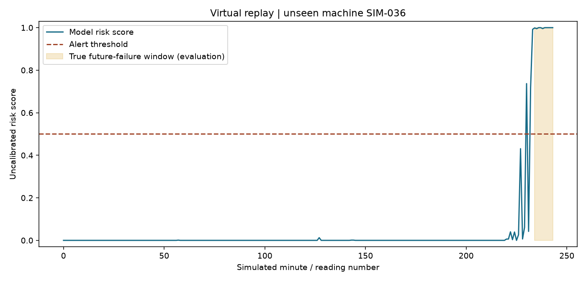
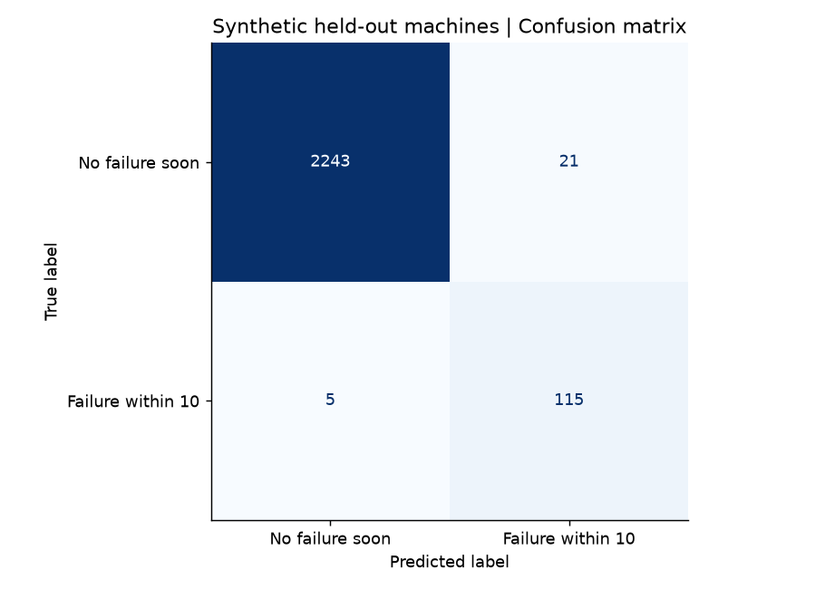
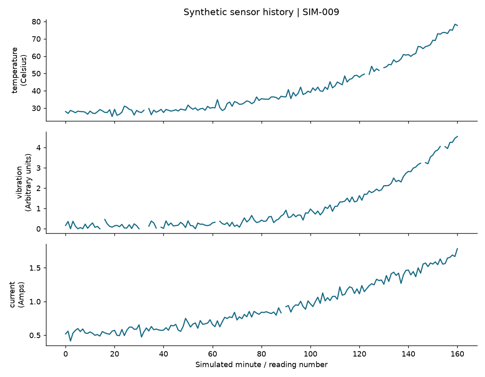
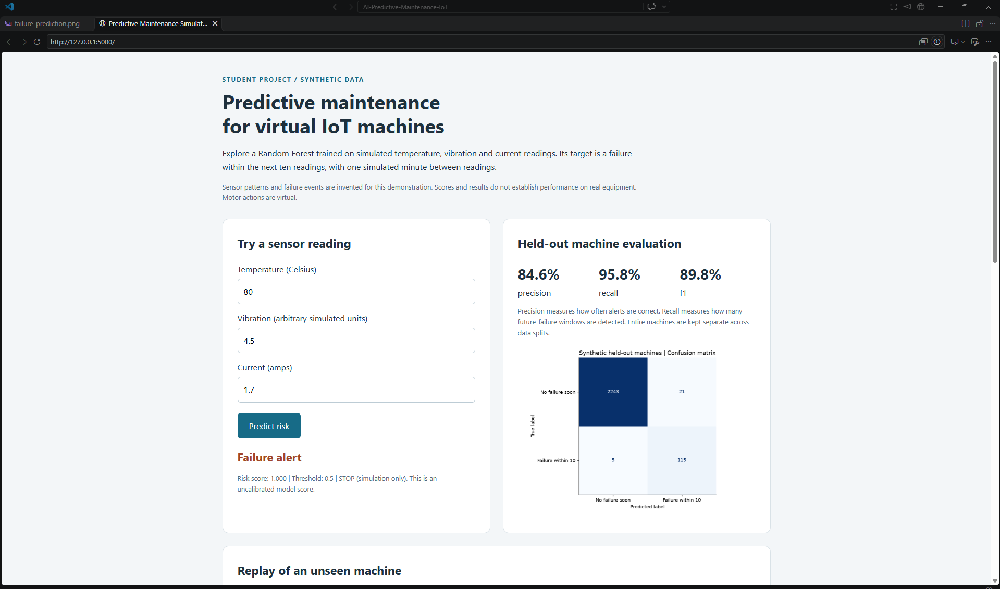
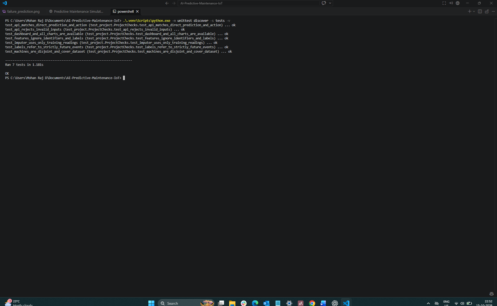

# AI Powered Predictive Maintenance for IoT Devices

A student project that learns from fictional temperature, vibration and current readings to flag a machine failure within the next ten readings. It runs without sensors or industrial equipment and produces a saved Random Forest model, evaluation charts, virtual machine replay, local dashboard and Flask prediction API.

The supplied project document is the requirements source. Its opening requests datasets and virtual simulation; that is the scope implemented here. The later physical wiring examples are not required for this version. No external dataset, company claim or market statistic is used. Numeric sensor behavior and simulation rules are explicitly invented and documented in [Dataset assumptions](data/DATASET.md).

Start with [the guided implementation](docs/STEP_BY_STEP.md). It explains what to do, why, the expected result, common mistakes and verification for each phase.

## Problem and objective

The project document proposes anticipating machinery failures from sensor data to support maintenance decisions and reduce downtime. This implementation demonstrates that workflow in a virtual environment. It does not establish cost savings, operational safety or prediction performance on actual machines.

The target is binary: **will the fictional machine fail in the next 10 readings?** Readings are one simulated minute apart. This is not a remaining-useful-life model. Alerts use a fixed 0.5 score threshold.

## Technology options and selected approach

| Option | Approach | Data and output | Difficulty and compute |
| --- | --- | --- | --- |
| A | Python, Pandas, NumPy, Scikit-learn, Logistic Regression | Sensor rows; binary failure prediction | Simplest model option; CPU approach |
| B selected | Python, Pandas, NumPy, Scikit-learn, Random Forest, Matplotlib, Flask | Synthetic time-stamped sensor rows; failure score, alerts, charts and API | Beginner to intermediate; delivered code runs on CPU |
| C | TensorFlow/Keras and LSTM, as named in the document | Ordered sensor sequences; sequence-based prediction | More complex; not implemented or benchmarked here |

Option B follows the document's working model example and keeps the project manageable. An LSTM is not needed to run this implementation. Random Forest does not require input standardization here; missing values are handled by a fitted median imputer. Matplotlib generates the graphs. Joblib saves the model and imputer together.

## Architecture

```text
Invented sensor degradation histories
                  |
                  v
CSV with timestamps, machine IDs and future-event labels
                  |
                  v
Split whole machines into train / validation / test
                  |
                  v
Current sensor values + three interaction features
                  |
                  v
Training-only median imputation + Random Forest
                  |
                  v
Saved pipeline + fixed threshold
                  |
          +-------+-------+
          |               |
          v               v
Held-out replay       Flask /predict
          |               |
          +-------+-------+
                  v
Failure score -> alert -> virtual STOP or RUN
                  |
                  v
Evaluation charts, dashboard, logs and proof files
```

`failure`, future labels, timestamps and machine identifiers are excluded from model features. Whole-machine separation prevents a machine's readings from appearing in both training and evaluation. Validation and test results are reported separately; this version performs no hyperparameter or threshold tuning.

## Project structure

```text
AI-Predictive-Maintenance-IoT/
|-- data/              Generated CSV and data dictionary
|-- notebooks/         Reserved for optional exploration; no notebook required
|-- src/               Data, features, training, prediction, simulation and API
|-- models/            Fitted pipeline saved as a .pkl artifact
|-- outputs/           Metrics, predictions, split IDs, replay summary and run log
|-- images/            Generated evaluation and sensor graphs
|-- docs/              Guided implementation, design and GitHub proof plan
|-- tests/             Label, split and API checks
|-- main.py            Command-line entry point
|-- setup.ps1          Windows setup
|-- setup.sh           Mac/Linux setup
|-- requirements.txt   Exact package versions from the tested environment
|-- .gitignore         Environment, cache and temporary-file exclusions
`-- README.md
```

## Installation

The delivered workflow was tested using Python 3.12.14 on Windows. Use Python 3.12 for the recorded dependency versions. Installation requires access to the listed Python packages; running the generated data workflow requires no external service or dataset. Mac/Linux setup commands are provided but have not been executed in this delivery.

Windows PowerShell, from this folder:

```powershell
py -3.12 -m venv .venv
.\.venv\Scripts\python.exe -m pip install -r requirements.txt
.\.venv\Scripts\python.exe main.py run
```

If the `py` launcher is absent but `python` is Python 3.12, use `python -m venv .venv` for the first command. The provided `setup.ps1` performs environment creation and dependency installation. Activation is optional because the commands explicitly select the environment's Python.

Mac/Linux, with Python 3.12 already available:

```bash
python3.12 -m venv .venv
.venv/bin/python -m pip install -r requirements.txt
.venv/bin/python main.py run
```

## Run each phase

The commands below assume your virtual environment is active. On Windows, you can replace `python` with `.\.venv\Scripts\python.exe` throughout. On Mac/Linux, use `.venv/bin/python`.

```text
python main.py generate
python main.py train
python main.py simulate
python main.py predict --temperature 35 --vibration 0.3 --current 0.6
python main.py predict --temperature 80 --vibration 4.5 --current 1.7
python main.py serve
```

Open `http://127.0.0.1:5000` after starting the server. Keep that terminal running. Press Ctrl+C to stop it. Port 5000 is used by default; `python main.py serve --port 5001` selects another local port.

`python main.py run` performs generation, training and replay and saves `outputs/run.log`. It does not start the server. Generation and training replace their corresponding artifacts. Regenerate and retrain together so the dataset, split IDs and model correspond to one run.

Slow down the replay with `python main.py simulate --delay 0.05`. Each recorded reading still represents one simulated minute; this delay changes only wall-clock playback speed.

## API example

With the server running, use a second PowerShell terminal:

```powershell
$body = @{temperature=80; vibration=4.5; current=1.7} | ConvertTo-Json
Invoke-RestMethod -Uri 'http://127.0.0.1:5000/predict' -Method Post -ContentType 'application/json' -Body $body
```

The response includes `Prediction`, `failure_predicted`, `failure_risk_score`, `threshold`, `horizon_readings` and `motor_action`. The score is uncalibrated; it is not a validated real-world failure probability. Inputs must contain exactly three finite numeric sensor values. Demo input bounds are temperature -50 to 200 Celsius, vibration 0 to 100 arbitrary units, current 0 to 100 amps. These bounds are API guards, not machine specifications or safety limits.

## Recorded synthetic results

The default run used 80 machines and 16,764 readings, with 56 training, 12 validation and 12 test machines. The terminal failure reading of each machine was excluded from modeling. Results below are measured outputs of that run, not performance goals.

| Test measure | Random Forest | Always predict no imminent failure |
| --- | ---: | ---: |
| Accuracy | 98.91% | 94.97% |
| Precision | 84.56% | 0.00% |
| Recall | 95.83% | 0.00% |
| F1 | 89.84% | 0.00% |

There are 2,384 test readings, including 120 positive future-failure readings. The test confusion matrix contains 2,243 true negatives, 21 false positives, 5 false negatives and 115 true positives. These are **reading-level** measures; recall is not an event-level machine detection rate. Overlapping windows are correlated, so individual rows are not independent experiments.

Accuracy alone is insufficient because the majority class dominates. Full validation, test and baseline metrics are saved in `outputs/metrics.json`.

The default replay uses unseen machine SIM-036. Its first alert occurs 14 simulated minutes before its recorded failure. Because the target is a failure within ten readings, alerts before that window count as false positives. Virtual STOP actions do not change the recorded run-to-failure trajectory; this replay does not demonstrate that an intervention prevents failure.

## Visual results







Additional graphs show the precision-recall curve and feature importance. Impurity-based feature importance is descriptive, particularly because the interaction features are correlated with their source sensors.

## Verification

After a full run:

```text
python -m unittest discover -s tests -v
```

Checks cover strictly future event labels, disjoint machine splits, training-only imputation, exclusion of label features, matching API and direct predictions, malformed inputs, and dashboard/chart responses.

## GitHub and proof

Follow [the GitHub and proof plan](docs/GITHUB_PROOF_PLAN.md) for repository creation commands, documentation, an honest seven-day learning sequence and a screenshot checklist. This delivered folder is prepared for a repository; it has not been published to GitHub. No commits or screenshots of a GitHub repository are fabricated.

## Learning outcomes and limits

This project demonstrates synthetic sensor generation, a future-event classification target, missing-data handling, feature engineering, machine-separated evaluation, baseline comparison, model persistence, API input validation, virtual replay and reproducible proof artifacts.

It is an educational simulation. Sensor behavior, timing and failure mechanisms are invented and intentionally simple. Every generated machine eventually fails. There is no physical device integration, actual cloud transport, LSTM, real maintenance intervention or evidence of industrial reliability. Scores should be interpreted only within this simulation. The model has not been externally validated or calibrated.

## Proof of local execution

### Dashboard failure alert


### Automated checks

